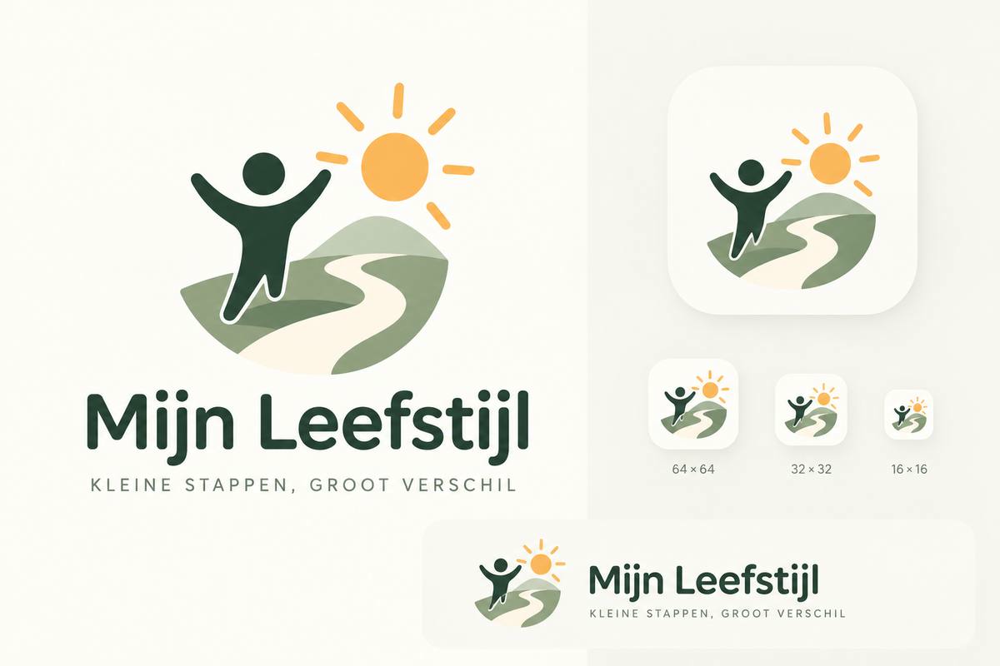

# Mijn Leefstijl — visuele richtlijnen (gekozen concept B)

_Status: gekozen beeldmerk en visuele richting door opdrachtgever op 29 oktober 2026; definitieve vectorassets en onderscheidbaarheidscontrole nog uit te werken._

## Vastgestelde identiteit
- Naam/woordmerk: **Mijn Leefstijl**. Eventueel motto: **Kleine stappen, groot verschil**.
- Gekozen beeldmerk: **Concept B, verbeterde balans** — een minimalistische optimistische menselijke figuur met omhoog geheven armen, **warme gele zon rechtsboven**, en **een vloeiend groen landschap met wit S-vormig pad naar rechtsonder**.
- **Geen losse blaadjes, planten, medische kruizen, schilden, zorgverzekeraarachtige symboliek of extra versieringen.**
- Beeldmerk moet energie, plezier, voortgang en eigen regie uitstralen; niet aanzetten tot extreme fitness of een prestatiedwang.
- Behoud de uitgebalanceerde onderkant en doorlopende bocht van het pad van de goedgekeurde referentie; de rechteronderzijde mag niet leeg aanvoelen.
- Het beeldmerk is leidend. De andere illustraties uit de eerdere [conceptboard](mijn-leefstijl-goedgekeurde-conceptboard.svg) blijven inspiratie voor iconen en lege statussen, **niet voor een ander hoofdlogo**.

## Goedgekeurde visuele logo-referentie

Deze afbeelding is een **AI-gerenderde conceptpresentatie** met composities voor primaire, horizontale en kleine app-iconen. Hoewel de preview in een SVG-container staat, **is de onderliggende tekening raster**, nog **geen echte bewerkbare vector** en niet automatisch geschikt als definitieve productieasset.

## Kleuren en typografie
Respecteer bestaande tokens in `src/app/globals.css`:
- achtergrond `#f8f7f1` (off-white), tekst `#22392d`, primair `#2e6b52` (donkergroen);
- accenten saliegroen / warm zonnig geel-oranje, alleen gedoseerd; geen overdadige gradients;
- Inter/system-sans en goed leesbare afgeronde vormentaal die aansluit op bestaande appcomponenten.

## Logo-uitwerkingen voor implementatie
1. Vectoriseer/redesign het goedgekeurde icoon met zo min mogelijk herkenbare eenvoudige contouren, maar volg de gekozen compositie nauw.
2. Lever `icon-only`, horizontaal logo met woordmerk en waar nodig gestapelde variant; licht/donker/monochroom.
3. Vereenvoudig de kleine icon-variant expliciet (16, 32, 64, 180, 192 en 512 px) zonder herkenbaarheid te verliezen. Geen microdetails of onleesbaar motto op 16 px.
4. Maak SVG bronbestanden en waar nodig PNG-app-/PWA-iconen; laat previews op echte schermgroottes zien.
5. Logo in navigatie, onboarding/login, favicon/PWA en optioneel PDF-ontwerp B; behoud rustige, toegankelijke, mobile-first interface en laat dagelijkse acties altijd dominant.
6. Decoratieve iconen/illustraties mogen het logo niet imiteren; kies consistent Lucide voor navigatie en spaarzame speelse tekeningen voor empty states/mijlpalen.

## Originaliteit en gebruiksrechten — nog te controleren
De opdrachtgever merkte terecht op dat het gekozen beeldmerk bekend voorkomt. Een eerste openbare beeld-/webzoekactie vond **visueel soortgelijke ontwerpen**, waaronder [online therapieservice via Hotmart](https://hotmart.com/pt-br/marketplace/produtos/sessao-terapeutica-online/B104062572S), [Breakthrough Healing & Wellness](https://www.breakthroughhealingwellness.com/contact-us) en algemene wellness-logo's. De gedeelde bouwstenen (opgeheven armen, zon, kronkelpad) zijn veelgebruikt. **Er is geen bewezen exacte kopie aangetroffen, maar dit is geen volledige reverse-image-, auteursrecht- of merkenonderzoek.**

Voor algemene publieke/zakelijke release:
- Controleer visuele gelijkenis met relevante merken en logo's, in elk geval via BOIP (Benelux), EUIPO en zo nodig WIPO en gerichte beeldzoekacties; let ook op soortgelijke diensten.
- Leg herkomst van definitieve eigen vectortekening en rechten/licenties vast; neem geen beschermde beelden of stock-logo's over.
- Laat bij materiële gelijkenis de uiteindelijke verhoudingen/vormen onderscheidender uitwerken **binnen** de gekozen identiteit; leg die wijziging eerst ter review voor.
- Geen claim van merk-exclusiviteit of juridische vrijwaring voordat dat onderzoek is afgerond.

## Checklist
- [ ] Concept B in echte, originele vectorassets getekend en gereviewd
- [ ] 16–512 px varianten visueel getoetst
- [ ] Contrast, screenreader-semantiek en mobiele uitlijning gecheckt
- [ ] Originaliteits-/merkencheck gedocumenteerd vóór publiek/zakelijk gebruik
- [ ] Uitrol via PR met voor/na screenshots met fictieve data, lint/typecheck/build
